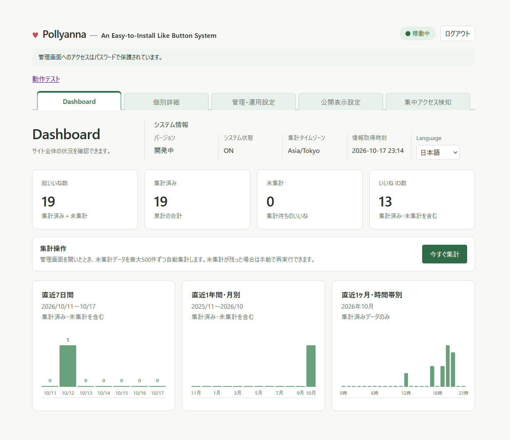
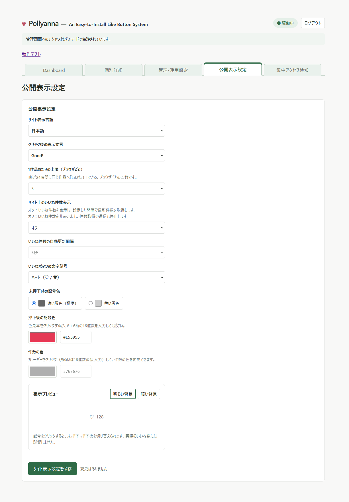
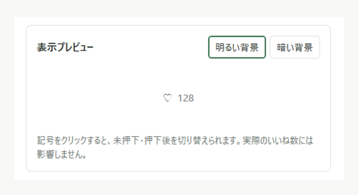

# Pollyanna — Simple Like-button System

Webページに設置できる、軽量ないいねボタンシステムです。ボタンの表示設定、いいねの記録・集計、管理画面、Webインストーラーを備えています。

**バージョン：`v1.0.0-beta1`（β版）**

## 画面紹介

※掲載画像はすべて開発中の画面です。表示されている数値はテストデータであり、正式版では画面や仕様が変更される場合があります。

いいねの総数や、日別・月別・時間帯別の集計を確認できます。

ボタンの記号や色、クリック後の文言、24時間ごとの押下回数、件数表示などを設定できます。 
日本語・英語の表示に対応しています。

管理画面内で、背景色や押下状態による見え方を確認できます。

## 制作背景

自サイトで運用していたWeb拍手のセキュリティ面に不安があり、代わりとなる仕組みとして、以下の点を盛り込んで制作しました。

- 閲覧者が気軽に反応できるよう、多くの人が使い慣れていると思われる「いいねボタン」の形式を採用。
- コメント投稿機能は設けず、反応を送る機能に絞る。 
  （理由：セキュリティホールになり得る＆入力内容の検証や迷惑投稿への対処が必要になる）
- いいねの押下を記録・集計することで、コンテンツへの反応が多い日時や曜日を把握でき、サイトの更新時期やコンテンツ運営を考える材料として活用できる……かも？

## 担当範囲・開発方法

企画、要件定義、設計、実装、テスト、ドキュメント作成まで。つまりは開発全体。 
コーディングの一部には、AI支援を使用。

## 必要環境・導入方法

PHP 8.1以降（PDO MySQL拡張）と、MySQLまたはMariaDBを使用します。

導入方法と運用上の注意事項は、以下を参照してください。

- [日本語ガイド](Simple_Like_Button/README.md)
- [English guide](Simple_Like_Button/README.en.md)

## β版について

現在はβ版です。画面や仕様は今後変更される場合があります。現在の配布ZIPは新規導入用で、既存環境への上書き更新には対応していません。

`legacy/`配下は旧試作版の参照用コードです。そのまま運用しないでください。

## ライセンス

GPL-3.0-only。全文は[LICENSE](Simple_Like_Button/LICENSE)を参照してください。

Copyright (C) 2026 Nikukiu SYSTEM
