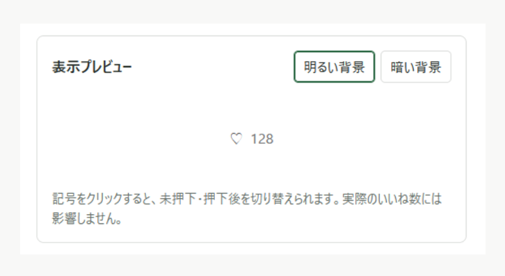
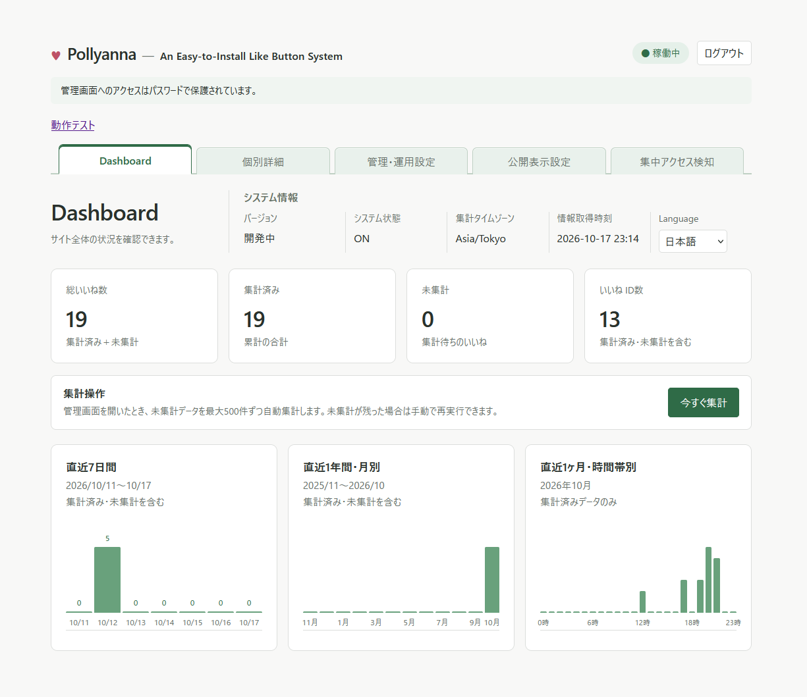
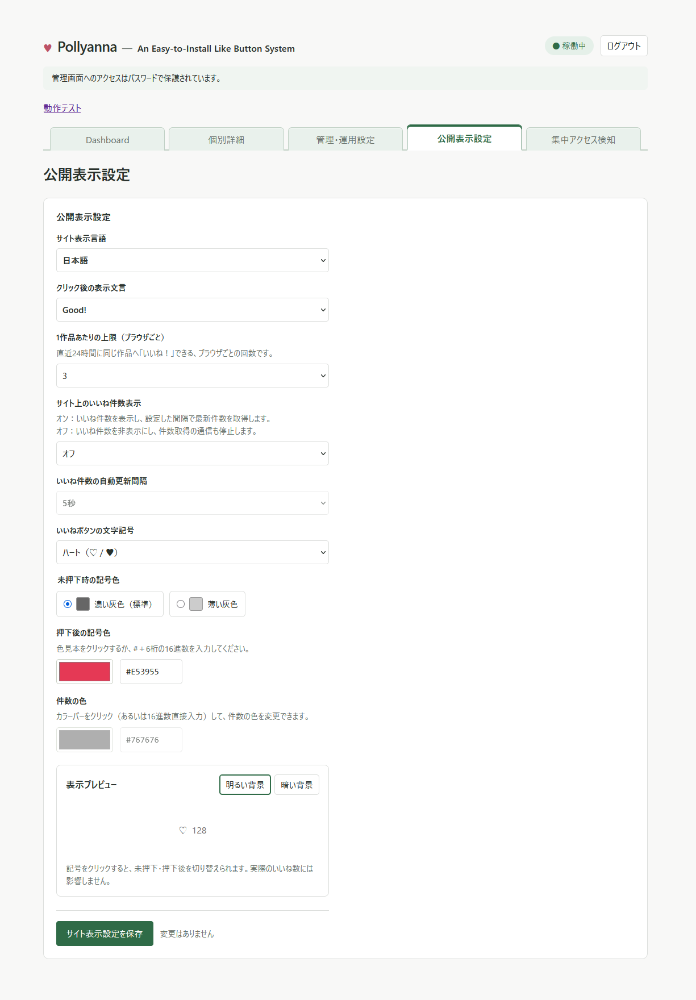

# Pollyanna — Simple Like-button System

Webページに設置できる、軽量な自己ホスト型のいいねボタンシステムです。ボタンの表示設定、いいねの記録・集計、管理画面、Webインストーラーを備えています。

**v1.0.0-beta2（β-2版）をプレリリースとして公開しました。** 
（[Pollyanna β-2 のリリースページ](https://github.com/studiol1998/simple-like-button-system/releases/tag/v1.0.0-beta2)）

> β-2は実地テスト前のプレリリースで、正式版ではありません。配布ZIPは新規導入専用です。既存環境への上書き更新やインストーラーの再実行には使用しないでください。

[Pollyanna β-2 をダウンロード（ZIP）](https://github.com/studiol1998/simple-like-button-system/releases/download/v1.0.0-beta2/Pollyanna-v1.0.0-beta2.zip)

導入方法：[日本語ガイド](Simple_Like_Button/README.md) / [English guide](Simple_Like_Button/README.en.md)

## 画面例

開発中の画面例です。数値はテストデータであり、正式版では画面や仕様が変わる場合があります。

### 管理画面内の表示プレビュー

背景色や未押下・押下後の見え方を確認できます。管理画面内のプレビューであり、実サイト上の設置画面ではありません。

### ダッシュボード

いいねの総数、集計済み・未集計の件数、日別・月別・時間帯別の集計を確認できます。

公開表示設定の画面例を見る

ボタンの記号や色、クリック後の文言、24時間の押下上限、件数表示・更新間隔などを設定できます。日本語・英語の表示に対応しています。

## 主な特徴

- HTMLに埋め込んで使えるいいねボタン。日本語・英語の表示、記号・色・成功メッセージを設定できます。
- 匿名ブラウザ・識別子ごとに直近24時間の押下上限を設定できます（1～5回、初期値3回）。
- 日別・月別・年別・時間帯別に反応を集計し、管理画面で確認できます。
- パスワード保護された管理画面で、表示設定や集中アクセス検知・一時ブロックを管理できます。
- Webインストーラーを備えています。タイムゾーン変更時には集計値をCSVへ保存してリセットできます。

## 必要環境・導入方法

正式動作要件はPHP 8.3以上（PDO MySQL・JSON・セッション）と、MySQLまたはMariaDBのInnoDBです。本番管理画面にはHTTPSが必要です。設定・アーカイブの書込権限、管理セッションの保存条件、config/・log/へのWebアクセス拒否も確認してください。

PHP 8.2以下は公式サポート対象外です。インストーラーの導入許容範囲と検証実績は、公式サポートとは別です。必要なセキュリティ修正が適用されたPHPを使用してください。

配布ZIPの導入手順、埋め込み例、詳しい動作条件・制約は、アプリ側READMEにまとめています。

- [日本語：機能・必要環境・設置手順](Simple_Like_Button/README.md)
- [English: features, requirements, and installation](Simple_Like_Button/README.en.md)

技術資料は[現行仕様](Simple_Like_Button/docs/Specification.md)、[設置・運用・復旧](Simple_Like_Button/docs/Installation.md)、[開発状況・検証範囲](Simple_Like_Button/docs/DevelopmentPlan.md)を参照してください。β-2公開時点に固定した資料は、アプリ側READMEの詳細文書リンクから参照できます。

## 制作背景

自サイトで運用していたWeb拍手のセキュリティ面に不安があり、代わりとなる仕組みとして制作しました。

- 閲覧者が気軽に反応できるよう、使い慣れた「いいねボタン」の形式を採用しました。
- コメント投稿機能は設けず、反応を送る機能に絞りました。入力内容の検証や迷惑投稿への対処が必要になるためです。
- 反応が多い日時を集計し、サイトの更新時期やコンテンツ運営を考える材料にすることを目指しています。

## 制作・開発方法

制作：**にくきぅSYSTEMs（Nikukiu-SYSTEMs）**

企画、要件定義、設計、実装、テスト、ドキュメント作成まで、開発全体を担当しています。コーディングの一部にはAI支援を使用しています。

旧試作版のlegacy/と、Simple_Like_Button/docs/archive/の履歴資料は参照用です。旧コードをそのまま本番運用したり、旧文書を現行仕様として使用したりしないでください。

## ライセンス

GPL-3.0-only（GNU General Public License version 3のみ）。全文は[LICENSE](Simple_Like_Button/LICENSE)を参照してください。

Copyright (C) 2026 Nikukiu-SYSTEMs
