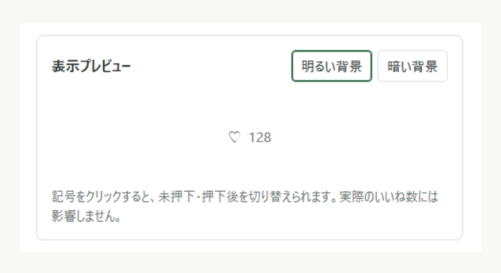
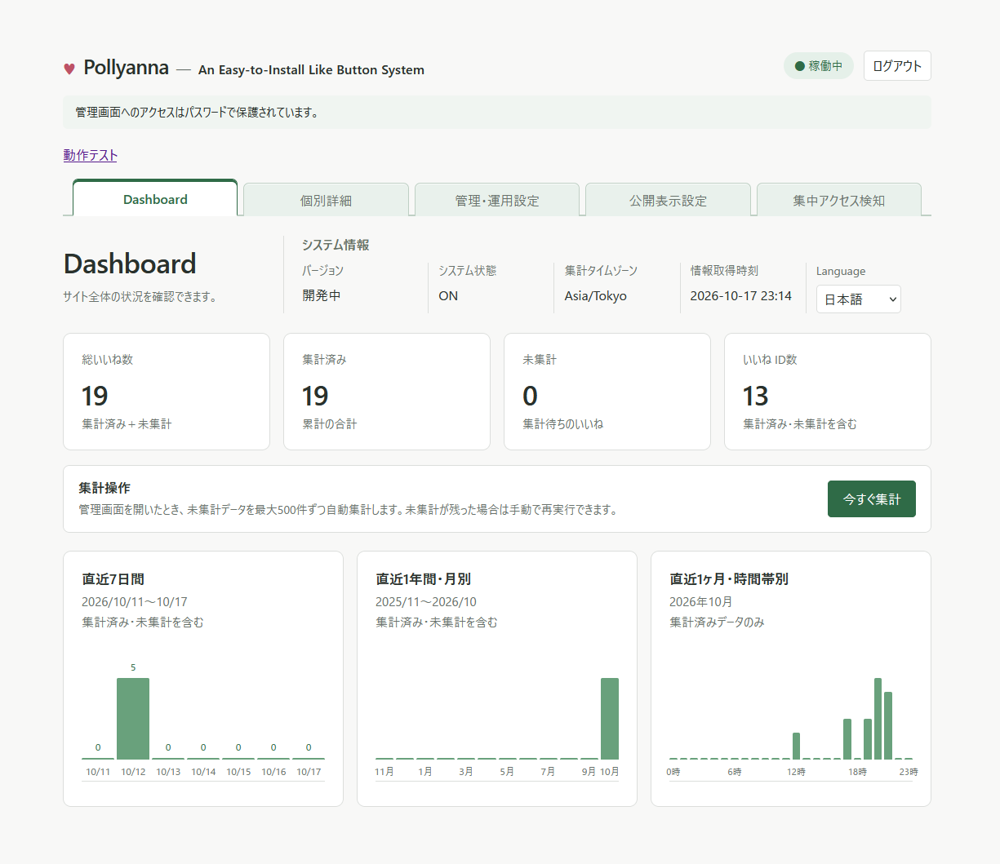
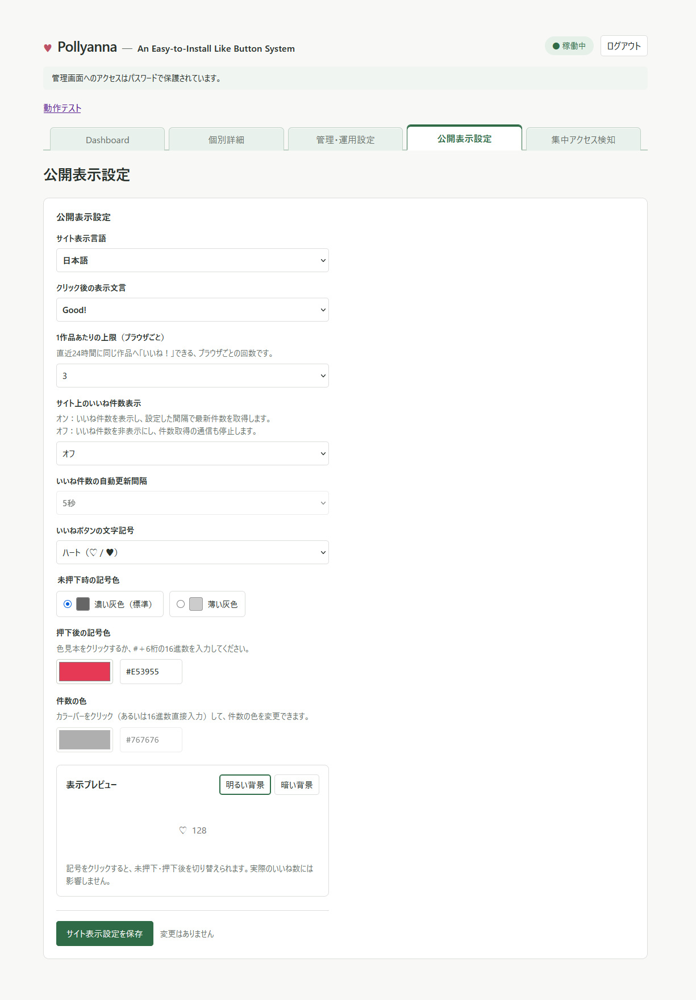

# Pollyanna — Simple Like-button System

[日本語](README.md) | English

Pollyanna is a self-hosted Like button system for embedding in web pages. Customize the button's appearance and Like limits, and view collected reactions in the Admin dashboard. A Web installer guides you through setup.

**Applicable version: v1.0.0-beta2 (β-2)**

> β-2 is a pre-release before field testing, not a stable release. The distribution ZIP is for new installations only. Do not use it to overwrite an existing installation or rerun its installer.

[Download Pollyanna β-2 (ZIP)](https://github.com/studiol1998/simple-like-button-system/releases/download/v1.0.0-beta2/Pollyanna-v1.0.0-beta2.zip)

## Screenshots

These are development screenshots with test data. Screens and specifications may change before the stable release. The examples below show the Japanese UI; the application also supports English.

### Display Preview in the Admin Dashboard

This preview checks backgrounds and the button's unliked/liked appearance. It is not a screenshot of a button embedded in a live site.



### Dashboard

View total Likes, aggregated and unaggregated counts, and daily, monthly, and hourly statistics.



<details>
<summary>Show the public display settings screenshot</summary>

Configure symbols, colors, success messages, the 24-hour Like limit, count visibility, and refresh intervals.



</details>

## Main Features

- Japanese/English display, success messages, and six symbol presets with configurable colors
- A rolling 24-hour limit per anonymous browser and identifier: 1–5 Likes, default 3
- Like state restoration, optional public counts, and automatic refresh: default 5 seconds; 0 disables refresh
- Daily/monthly/yearly/hourly aggregation and an automatic aggregation threshold: default 1,000 events
- A password-protected Admin dashboard, display preview, and widget test
- Abnormal access detection, temporary blocking, and manual release
- CSV archival and aggregate reset when changing the time zone

## Requirements and Installation Conditions

| Item | Requirement |
| --- | --- |
| PHP | Official runtime requirement: 8.3 or later, with PDO MySQL, JSON, and sessions |
| Database | InnoDB on MySQL or MariaDB; prepare a dedicated empty database |
| Administrative transport | Production Admin requires HTTPS; TLS-terminating proxies require explicit configuration |
| Sessions | PHP's standard files handler and a writable, flat storage destination with working exclusive locks |
| Files | Write access to config/ and log/, with Web access to both directories denied |
| Embedding pages | HTTP/HTTPS with JavaScript, Fetch, and localStorage available |

PHP 8.2 and earlier are outside official support. The current installer permits 8.1–8.2, but the unsupported-version warning is not implemented. PHP 8.0 and earlier cannot be installed. Recorded automated verification used PHP 8.5.12 (CLI and the built-in HTTP server); this does not guarantee all PHP 8.3-or-later environments, production TLS, or real-browser operation. Use PHP within its security support period with necessary security fixes applied.

Hierarchical administrative session storage, Redis, Memcached, and custom handlers are unsupported. On Apache, verify that .htaccess is actually honored; other web servers require equivalent access denial. No cron, Redis, external API, or additional library is required. See [Installation Chapters 1–5](https://github.com/studiol1998/simple-like-button-system/blob/v1.0.0-beta2/Simple_Like_Button/docs/Installation.en.md) for details.

## Quick Installation

1. Prepare a dedicated empty database and database user with CREATE, SELECT, INSERT, UPDATE, and DELETE privileges on that database. Record the host, port, database name, username, and password. The installer does not create the database itself or its user.
2. Extract Pollyanna-v1.0.0-beta2.zip and upload pollyanna/ to the server. Preserve its relative layout and check write permissions and Web access denial for config/ and log/.
3. Open /your-install-path/install/ and complete environment checks, database connection, and basic settings. Confirm the administrative environment, HTTPS administrator Origin, case-sensitive administrator path, time zone, and password before execution. Passwords require at least 12 Unicode code points and no more than 72 UTF-8 bytes.
4. After completion, remove the entire install/ directory. Admin is unavailable while it remains.
5. Sign in through the verified HTTPS administrator URL and check settings saves and Widget test. Test clicks count as real data in statistics.
6. Add the following to the HTML where the button should appear. Replace /pollyanna/, the URL, and the identifier with actual values.

```html
<link rel="stylesheet" href="/pollyanna/assets/like.css?v=1">
<div data-pollyanna-like data-identifier="article-001" data-url="https://example.com/articles/001"></div>
<script defer src="/pollyanna/assets/like.js"></script>
```

data-identifier distinguishes the aggregation subject. Specify it manually to keep a subject fixed, and use distinct values for different subjects. Multiple buttons for the same subject can share a value. Automatic generation when the attribute is omitted can collide across pages. Manual values are limited to 100 Unicode code points; whitespace, control characters, and ASCII symbols other than “-” and “_” are prohibited. Update the URL's v value when changing CSS.

For embedding on an external Origin, add permission in Admin. The installation URL's Origin also needs permission for URL registration. See [Installation Chapter 6](https://github.com/studiol1998/simple-like-button-system/blob/v1.0.0-beta2/Simple_Like_Button/docs/Installation.en.md) for embedding, installation locations, and message editing.

## Important Limitations

- Installation with config/, src/, or other components separated outside the web root is currently unverified and unsupported.
- Clearing localStorage or changing the browser or Origin may lose Like state and limit continuity. Anonymous browser identification is not identity authentication.
- Abnormal access detection can combine visitors on shared networks or reverse proxies and cause false blocks. New installations enable detection and automatic blocking. Inspect history and tune conditions. β-2 has fail-open paths when detection fails; success or protection of the public API as a whole is not guaranteed.
- After a partial installation failure, consult recovery procedures rather than deleting settings/progress markers unconditionally or reinstalling. A session-storage 503 may occur after settings have changed; do not automatically resend.
- A time zone change archives aggregates, including pending events, as CSV and then resets aggregates and public counts. Archives are not automatically deleted. Prepare appropriate backups.
- The administrative HTTP exception is only for explicitly configured, direct-loopback local development. Do not use it for LAN/tunnel/proxy exposure or as an authentication-bypass recovery method.

## Documentation

The following guides apply to v1.0.0-beta2. docs/ and screenshots are not bundled in the distribution ZIP; accessing them requires an Internet connection. install/readme.php displays README as plain text rather than rendering images or Markdown links. Copy the required URL to open it.

- [Installation, operations, configuration, and recovery (Installation)](https://github.com/studiol1998/simple-like-button-system/blob/v1.0.0-beta2/Simple_Like_Button/docs/Installation.en.md)
- [Behavior, data, and security (Specification)](https://github.com/studiol1998/simple-like-button-system/blob/v1.0.0-beta2/Simple_Like_Button/docs/Specification.en.md)
- [Development status, verification scope, and outstanding issues (DevelopmentPlan)](https://github.com/studiol1998/simple-like-button-system/blob/v1.0.0-beta2/Simple_Like_Button/docs/DevelopmentPlan.en.md)

## License and Credits

GPL-3.0-only (GNU General Public License version 3 only). See the bundled [LICENSE](LICENSE) for the full text. No additional proprietary conditions restrict the use, modification, or redistribution permitted by the GPL.

Created by Nikukiu-SYSTEMs (にくきぅSYSTEMs), pronounced “Nikukiu Systems.”

Copyright (C) 2026 Nikukiu-SYSTEMs
