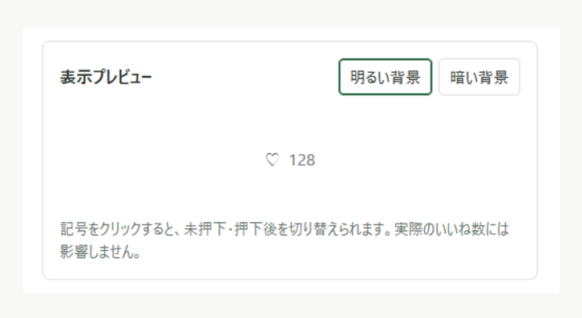
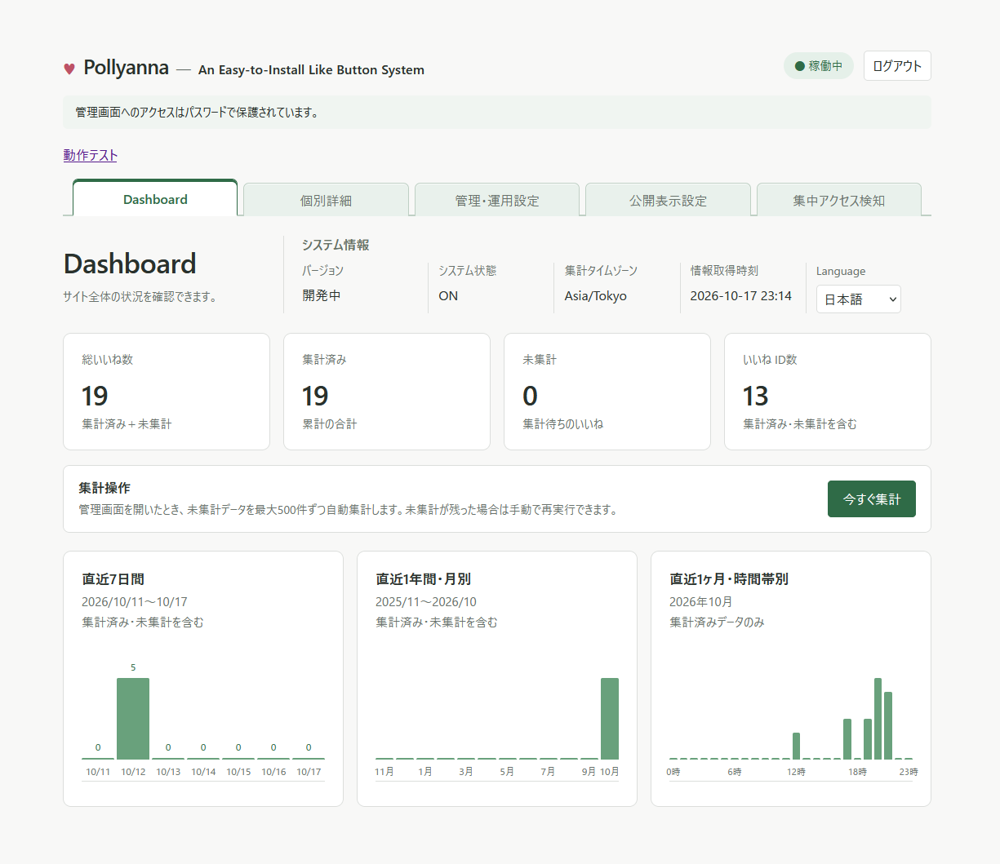
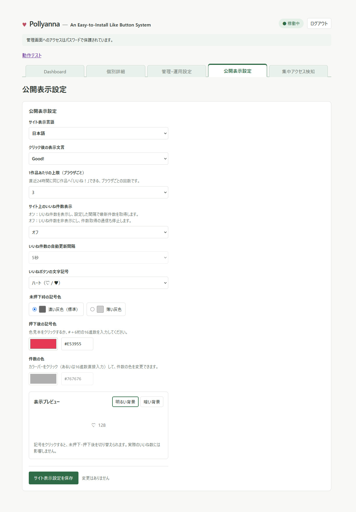

# Pollyanna — Simple Like-button System

日本語 | [English](README.en.md)

Pollyannaは、Webページに埋め込んで使う自己ホスト型のいいねボタンシステムです。ボタンの見た目や押下上限を設定でき、集まった反応を管理画面で確認できます。Webインストーラーで導入できます。

**対象版：v1.0.0-beta2（β-2）**

> β-2は実地テスト前のプレリリースで、正式版ではありません。配布ZIPは新規導入専用です。既存環境への上書き更新やインストーラーの再実行には使用しないでください。

[Pollyanna β-2 をダウンロード（ZIP）](https://github.com/studiol1998/simple-like-button-system/releases/download/v1.0.0-beta2/Pollyanna-v1.0.0-beta2.zip)

## 画面例

開発中の画面例です。表示されている数値はテストデータであり、正式版では画面や仕様が変わる場合があります。

### 管理画面内の表示プレビュー

ボタンの背景色や未押下・押下後の見え方を確認するためのプレビューです。実サイト上の設置画面ではありません。



### ダッシュボード

いいねの総数、集計済み・未集計の件数、日別・月別・時間帯別の集計を確認できます。



<details>
<summary>公開表示設定の画面例を見る</summary>

ボタンの記号・色、成功メッセージ、24時間の押下上限、件数表示・更新間隔を設定できます。



</details>

## 主な機能

- 日本語・英語の表示、成功メッセージ、6種類の記号と色の設定
- 匿名ブラウザ・識別子ごとの直近24時間の押下上限（1～5回、初期値3回）
- 押下状態の復元、件数表示の切替と自動更新（初期値5秒、0秒で更新なし）
- 日別・月別・年別・時間帯別集計と、自動集計開始しきい値（初期値1,000件）の設定
- パスワード保護された管理画面、表示プレビュー、動作テスト
- 集中アクセス検知・一時ブロック・手動解除
- タイムゾーン変更時のCSVアーカイブと集計値のリセット

## 必要環境と導入条件

| 項目 | 条件 |
| --- | --- |
| PHP | 正式動作要件は8.3以上。PDO MySQL、JSON、セッションが必要 |
| データベース | MySQLまたはMariaDBのInnoDB。Pollyanna専用の空DBを用意 |
| 管理通信 | 本番管理画面はHTTPS必須。TLS終端プロキシは明示設定が必要 |
| セッション | PHP標準files方式と、書込可能で排他ロックが機能する平坦な保存先 |
| ファイル | config/・log/への書込権限と、両ディレクトリへのWebアクセス拒否 |
| 設置ページ | HTTP/HTTPS。JavaScript・Fetch・localStorageが利用可能なこと |

PHP 8.2以下は公式サポート対象外です。現行インストーラーは8.1～8.2の通過を許容しますが、非サポート警告は未実装です。8.0以下はインストールできません。記録された自動検証環境はPHP 8.5.12（CLI・組み込みHTTPサーバー）であり、PHP 8.3以上の全環境や本番TLS・実ブラウザーの動作を保証するものではありません。必要なセキュリティ修正が適用された、サポート期間内のPHPを使用してください。

管理セッションの階層分割保存、Redis、Memcached、独自ハンドラーは未対応です。Apacheでは.htaccessが実際に有効なことを確認し、他のWebサーバーでは同等のアクセス拒否を設定してください。cron・Redis・外部API・追加ライブラリは必須ではありません。詳細は[設置・運用資料の第1～5章](https://github.com/studiol1998/simple-like-button-system/blob/v1.0.0-beta2/Simple_Like_Button/docs/Installation.md)を参照してください。

## 簡単な設置手順

1. Pollyanna専用の空DBとDBユーザーを用意し、そのDBへのCREATE・SELECT・INSERT・UPDATE・DELETE権限を設定します。ホスト・ポート・DB名・ユーザー名・パスワードを控えてください。インストーラーはDB本体やDBユーザーを作成しません。
2. Pollyanna-v1.0.0-beta2.zipを展開し、pollyanna/をサーバーへ配置します。内部の相対構成を維持し、config/・log/の書込権限とWebアクセス拒否を確認します。
3. /設置パス/install/を開き、環境確認・DB接続・基本設定を進めます。管理環境、HTTPSの管理Originと大文字・小文字を含む管理パス、タイムゾーン、管理パスワードを確認して実行します。パスワードは12 Unicodeコードポイント以上・UTF-8で72バイト以内です。
4. 完了後、install/ディレクトリ全体を除去します。残っている間は管理画面を利用できません。
5. 確認したHTTPS管理URLからログインし、設定保存と「動作テスト」を確認します。動作テストの押下は実データとして統計へ加算されます。
6. ボタンを置くHTMLへ次を追加します。/pollyanna/とURL、識別子は実際の対象へ変更してください。

```html
<link rel="stylesheet" href="/pollyanna/assets/like.css?v=1">
<div data-pollyanna-like data-identifier="article-001" data-url="https://example.com/articles/001"></div>
<script defer src="/pollyanna/assets/like.js"></script>
```

data-identifierは集計対象を区別する値です。集計を固定するには手動で指定し、別の対象には異なる値を使ってください。同じ対象の複数ボタンには同じ値を指定できます。属性省略による自動生成はページ間で衝突し得ます。手動値は最大100 Unicodeコードポイントで、空白・制御文字と「-」「_」以外のASCII記号は使えません。CSS変更時はURLのv値も更新します。

外部Originへ設置する場合は、管理画面で利用元を許可してください。設置先URLの登録にもOriginの許可が必要です。詳しい埋め込み・設置場所・文言編集は[設置・運用資料の第6章](https://github.com/studiol1998/simple-like-button-system/blob/v1.0.0-beta2/Simple_Like_Button/docs/Installation.md)を参照してください。

## 利用上の注意

- 公開領域外へconfig/・src/等を分離する設置は、現時点では未検証・未対応です。
- localStorageの消去やブラウザー・Originの変更で、押下状態や制限枠を引き継げない場合があります。匿名ブラウザ識別は本人認証ではありません。
- 集中アクセス検知では共有回線・リバースプロキシの利用者をまとめて判定し、誤ブロックする可能性があります。新規設置は検知・自動ブロックがONです。履歴を確認して条件を調整してください。β-2には検知障害時のfail-open経路があり、公開API全体の成功や防御を保証しません。
- インストール途中の失敗では、設定や進行マーカーを無条件に消したり再インストールしたりせず、復旧手順を確認してください。セッション保存障害の503でも設定変更済みの場合があるため、自動再送しないでください。
- タイムゾーン変更は未集計分も含むCSV保存後に集計値・公開件数をリセットします。アーカイブは自動削除されません。必要なバックアップを準備してください。
- 管理HTTP例外は明示設定した直接ループバックのローカル開発専用です。LAN・トンネル・プロキシ経由の公開や、認証回避の復旧手段に使わないでください。

## 詳細文書

以下はv1.0.0-beta2向けの資料です。docs/と画面画像は配布ZIPに同梱されないため、参照にはネット接続が必要です。install/readme.phpはREADMEをテキスト表示し、画像・Markdownリンクを描画しません。必要なURLをコピーして参照してください。

- [設置・運用・設定・復旧（Installation）](https://github.com/studiol1998/simple-like-button-system/blob/v1.0.0-beta2/Simple_Like_Button/docs/Installation.md)
- [動作規則・データ・セキュリティ（Specification）](https://github.com/studiol1998/simple-like-button-system/blob/v1.0.0-beta2/Simple_Like_Button/docs/Specification.md)
- [開発状況・検証範囲・未解決事項（DevelopmentPlan）](https://github.com/studiol1998/simple-like-button-system/blob/v1.0.0-beta2/Simple_Like_Button/docs/DevelopmentPlan.md)

## ライセンス・制作

GPL-3.0-only（GNU General Public License version 3のみ）です。正式全文は同梱の[LICENSE](LICENSE)を参照してください。GPLが認める利用・改変・再配布に独自の追加条件は設けません。

制作：にくきぅSYSTEMs（Nikukiu-SYSTEMs）。読みは「にくきうしすてむず」です。

Copyright (C) 2026 にくきぅSYSTEMs
